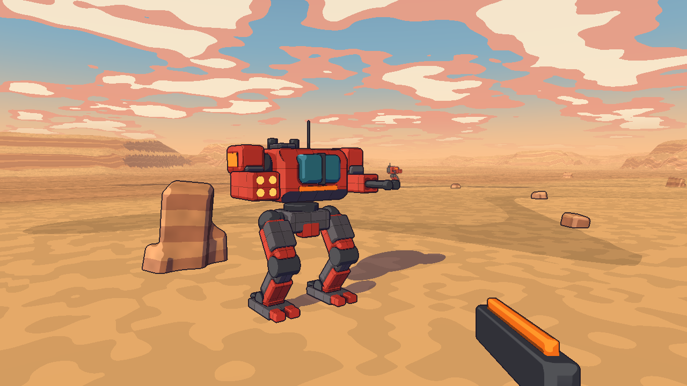
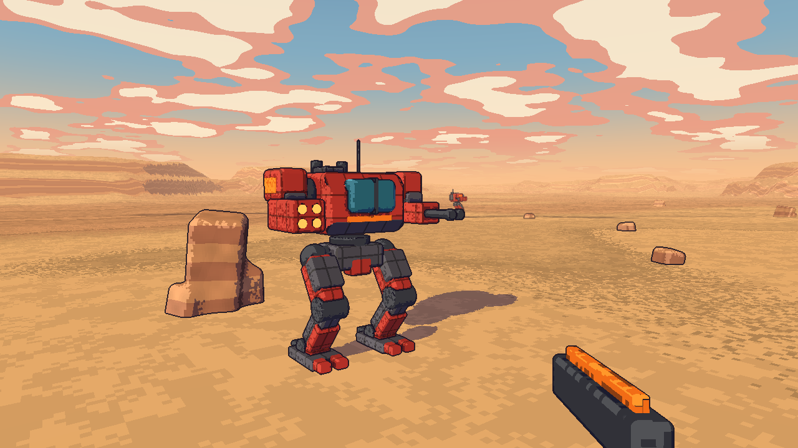
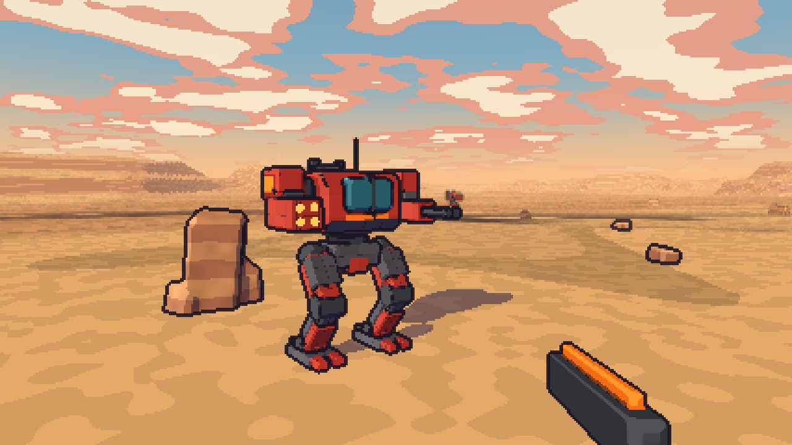

<div align="center">

# MechVR

**A VR mech game where every shape, effect and sound is made by code. Hold off growing waves of enemies from a working cockpit, shoot the arms off other mechs and graft them onto your own, climb out to weld your mech back together, and keep clear of the sand worm.**

[](LICENSE)
[](#-compatibility)
[](#-compatibility)
[](#-compatibility)
[](src)
[](#-features)

[](https://github.com/AEmotionStudio/MechVR/commits)
[](https://github.com/AEmotionStudio/MechVR/commits)

<!-- README media lives in the "README media (v1)" release, tag assets-v1. Each clip is uploaded twice:
     NAME.webp (animated, shown inline) and NAME.mp4 (full clip with sound, linked). -->

  
*From the cockpit: autocannon and plasma against crawlers, drones and a patrol, then an eject from the smoking mech. [▶ Watch with sound](https://github.com/AEmotionStudio/MechVR/releases/download/assets-v1/mechvr-cockpit.mp4)*

[Clips](#-clips) • [Features](#-features) • [Compatibility](#-compatibility) • [Installation](#-installation) • [Controls](#-controls) • [Waves and repair](#-waves-and-repair) • [Mechs and grafting](#-bodies-arms-and-grafting) • [Modding](#-editing-shapes-in-blender) • [Recording](#-recording-videos) • [License](#-license)

</div>

---

## 🎬 Clips

The game films these itself, sound included (see [Recording videos](#-recording-videos)). Follow a clip's link to watch it with sound.

<table>
<tr>
<td width="33%"><br><b>The sand worm</b>: it breaches in long arcs and comes up underneath whatever it is hunting. <a href="https://github.com/AEmotionStudio/MechVR/releases/download/assets-v1/mechvr-sandworm.mp4">▶ With sound</a></td>
<td width="33%"><br><b>The living mech</b>: a clawed, spined body that breathes, and the view from its cockpit of flesh and bone. <a href="https://github.com/AEmotionStudio/MechVR/releases/download/assets-v1/mechvr-living.mp4">▶ With sound</a></td>
<td width="33%"><br><b>The horde</b>: a field of enemy mechs, the far ones drawn as cards, with the worm breaching through them. <a href="https://github.com/AEmotionStudio/MechVR/releases/download/assets-v1/mechvr-horde.mp4">▶ With sound</a></td>
</tr>
</table>

---

## ✨ Features

*   **A cockpit you work with your hands.** Grab the throttle and the stick, pull the striped handle overhead to eject, and read your damage off the dashboard.
*   **Waves that grow.** Crawlers first, then drones, mechs dropped from the sky and turrets, and the sand worm every fifth wave, with a short break between waves to repair, take arms or change mechs.
*   **Damage part by part.** Torso, hips, legs and each arm go from intact to damaged to critical (trailing smoke) to destroyed. An arm that is shot off falls to the ground and takes its weapon with it.
*   **Eject, climb out, repair.** Eject and fight on with a pistol, then climb into another mech. Or climb out and weld your own mech back together with a torch, a stage at a time, out in the open. Eject from a mech whose torso is critical and its reactor blows a couple of seconds later; climbing out does not set it off.
*   **Two bodies, four arms, any combination.** A steel machine and a living creature. Shoot an arm off any mech and graft it onto your own.
*   **Plenty to fight.** Patrolling mechs, packs of crawlers, flights of drones, long-range turrets, and a 70 m sand worm.
*   **No asset files.** Everything on screen and every sound comes from code; there are no image, model or audio files. The mechs, cockpits and rocks are one short text file that you can edit by hand or in Blender while the game reloads it live.
*   **Small.** The whole game packs into a 68 KB self-extracting file (`make packed`).
*   **Crowds.** Far-away mechs are drawn as lit cards, so a hundred extra mechs cost little.
*   **Films itself.** Scripted cameras and a scripted pilot record clips with sound through ffmpeg.

### Three looks

Switch at any time (headset: **B**, window: **1**, **2**, **3**).

<table>
<tr>
<td width="33%"><br><b>Smooth</b></td>
<td width="33%"><br><b>Texel</b></td>
<td width="33%"><br><b>Chunky</b></td>
</tr>
</table>

---

## 🧩 Compatibility

MechVR is a prototype, developed on Linux with an Oculus Rift CV1 through SteamVR.

| Platform | Status |
|---|---|
| **Linux** | ✅ Should build on any distribution; see [Installation](#-installation). On Wayland it runs through XWayland. Sound goes to ALSA's default device, which reaches PipeWire or PulseAudio. |
| **Windows** | 🧪 Untested on real Windows. The game builds for Windows (a Win32 window, WGL, waveOut sound, and the OpenXR loader opened at startup). Under Wine, window mode draws the same picture as Linux, and keys, sound and recording work. The headset path has not been tried on a Windows PC yet. If it misbehaves, please [open an issue](https://github.com/AEmotionStudio/MechVR/issues) with what the console printed, or send a fix. |
| **macOS** | ❌ No. There is no PC VR runtime for macOS, and its OpenGL stops at 4.1. |

*   **Graphics:** a GPU with OpenGL 4.5, which covers most cards from the last ten years (Mesa or NVIDIA drivers on Linux, the vendor's own driver on Windows).
*   **Headset:** an OpenXR runtime with OpenGL support. SteamVR is what it is developed with. Monado, WiVRn and ALVR should also work but are untested. On Windows, if another runtime is active and the game cannot start in the headset, set SteamVR as the current OpenXR runtime in its settings.
*   **Controllers:** the controls are bound for Oculus Touch-style controllers (Rift, Quest). Other controllers get only trigger and menu unless your runtime remaps them.
*   **No headset?** `./mechvr --flat` plays in a window with mouse and keyboard.

---

## 📦 Installation

### 1. Tools and libraries

```bash
# Arch
sudo pacman -S --needed base-devel python glslang openxr libx11 libglvnd alsa-lib

# Debian / Ubuntu
sudo apt install build-essential python3 glslang-tools libopenxr-dev libgl-dev libx11-dev libasound2-dev

# Fedora
sudo dnf install gcc make python3 glslang openxr-devel mesa-libGL-devel libX11-devel alsa-lib-devel
```

The Arch list is the one the game is developed with. The Debian/Ubuntu and Fedora lists have not been tested yet; if one of them misses a package, please open an issue. Optional extras: `xz` for `make packed`, `ffmpeg` for recording clips, and Blender for editing shapes.

### 2. Build

```bash
git clone https://github.com/AEmotionStudio/MechVR.git
cd MechVR
make            # debug build: ./mechvr
make release    # small build: ./mechvr-release (prints its size)
make packed     # self-extracting small build: ./mechvr-packed (prints its size)
```

Every build checks each shader with `glslangValidator` and the shapes file with its own tool before building them into the program.

### 3. Run

```bash
./mechvr          # in the headset (start SteamVR first, or let it start on its own)
./mechvr --flat   # in a window, mouse and keyboard
./mechvr --foot   # start on foot beside your mech instead of in the cockpit
./mechvr --wave 5 # start at a later wave (5 brings the sand worm)
```

### Windows (untested)

**Download:** when a Windows zip is attached to a [release](https://github.com/AEmotionStudio/MechVR/releases), unzip it and run `play-in-window.bat` (mouse and keyboard) or `play-vr.bat` (headset; start SteamVR first). Both keep their window open if the game stops with an error, so you can read it.

**Build it yourself** in an [MSYS2](https://www.msys2.org/) **UCRT64** shell:

```bash
pacman -S --needed make python mingw-w64-ucrt-x86_64-gcc mingw-w64-ucrt-x86_64-glslang mingw-w64-ucrt-x86_64-openxr-sdk
make                  # debug build: ./mechvr.exe
make release          # small build: ./mechvr-release.exe
./mechvr.exe --flat   # in a window
./mechvr.exe          # in the headset
```

Started from the MSYS2 shell, the game finds MSYS2's OpenXR loader on its own. To run it from Explorer instead, copy the loader DLL from `C:\msys64\ucrt64\bin` next to `mechvr.exe`. Window mode needs no loader at all.

**Cross-compile from Linux** (this is how the release zip is made): install a MinGW-w64 cross compiler (Arch: `mingw-w64-gcc`, Debian/Ubuntu: `gcc-mingw-w64-x86-64`), then

```bash
make windows OPENXR_DLL=path/to/openxr_loader.dll
```

This writes `dist/MechVR-windows/` and `dist/MechVR-windows.zip`. Take `x64/bin/openxr_loader.dll` from `openxr_loader_windows-*.zip` on the [Khronos OpenXR SDK releases page](https://github.com/KhronosGroup/OpenXR-SDK-Source/releases); its Apache 2.0 license is copied in beside it. Without `OPENXR_DLL` the zip plays in a window only.

---

## 🎮 Controls

### In the headset (Touch controllers)

| Action | Control |
|---|---|
| Throttle | Grab the orange lever on the left console with the left grip and push or pull it. Or: left thumbstick up/down. |
| Turn the mech | Grab the stick on the right console with the right grip and move your hand sideways. Or: right thumbstick left/right. |
| Aim | Look at the target. The reticle follows your head. |
| Fire the left arm | Left trigger |
| Fire the right arm | Right trigger |
| Eject | Grab the striped handle above and in front of you and pull it down. Backup: hold X for one second. |
| Re-fit the seat to your head | Y |
| Walk on foot | Left thumbstick |
| Snap turn on foot | Right thumbstick |
| Fire pistol on foot | Right trigger |
| Board a mech (stand under a light pillar) | A |
| Graft an arm lying in reach | A |
| Climb out, leaving the mech standing | Hold A for a moment (when no arm is in reach) |
| Repair a mech of your side, on foot | Point your left hand at it and hold the left trigger |
| See the wave, your health and the part you are repairing, on foot | Look at your left wrist |
| Switch look (smooth / texel / chunky) | B |
| Restart | Menu button while holding the left grip |

### In a window (`--flat`)

| Action | Control |
|---|---|
| Throttle / walk | W, S |
| Turn the mech / strafe on foot | A, D |
| Look around | Hold the right mouse button and drag, or the arrow keys |
| Aim | Mouse pointer |
| Fire plasma / pistol | Left mouse button |
| Fire the left arm; on foot, the repair torch | Space (on foot, aim the torch with the mouse pointer) |
| Eject | X |
| Board a mech, graft an arm | E |
| Climb out | Hold E |
| Look presets | 1, 2, 3 |
| Free camera | F (then W A S D, Space up, Shift down) |
| Restart | R |
| Quit | Esc |

---

## 🌊 Waves and repair

The game is a run of waves. You start in your mech with a spare beside you, and the first wave arrives after 15 seconds.

*   **Each wave is bigger.** Wave 1 is a pack of crawlers. Drones join from wave 2, a mech dropped from the sky from wave 3, and turrets dropped within reach of you from wave 4. From wave 6 some come from the side. Every fifth wave brings the sand worm, tougher each time, with a lighter escort.
*   **Between waves** you have 25 seconds to repair, graft arms or change mechs. A chime means a wave is beaten, three beeps count down the last seconds of the break, and a horn sounds as the next wave arrives.
*   **Reading it:** the top of the cockpit screen shows the wave on the left and, on the right, how many enemies are left (red) or the seconds to the next wave (amber). On foot the same numbers are on the screen on your left wrist, with your health on its left edge and the part under your torch on its right.
*   **Stragglers:** when the last few enemies of a wave keep away for 15 seconds, amber pillars of light mark them.
*   **New mechs:** after a wave, if you have no mech to spare, a fresh one is dropped nearby. On foot with no mech left at all, one is sent within half a minute.
*   **Dying** starts the run again from wave 1.

**Repairing your mech**

*   **Climb out** by holding **A** (window: **E**) for a moment when no arm is in reach. You land beside the mech, facing it, and it stays standing. Unlike the eject, climbing out does not set off a critical reactor, so a badly hurt mech can be saved.
*   **The torch:** on foot, point your left hand at a mech of your side and hold the left trigger (window: hold **Space** and aim with the mouse). It reaches 14 m and restores 14 hit points a second to the part it touches. Its holes glow and close up as the part comes back, and each part steps back from critical to damaged to intact, with a chime at each step. A part that has come off cannot be repaired; graft another arm instead.
*   You are on foot while you work, so the break between waves is the time for it.
*   To try it straight away, `./mechvr --hurt 3` starts with every part of your mech critical.

`--sandbox` gives the fixed layout of earlier builds instead of waves (see [What is in the world](#-what-is-in-the-world)).

---

## 🦾 Bodies, arms and grafting

A mech is a body plus whatever arm is mounted on each shoulder. Any arm fits either side of either body; an arm made for the other side is drawn mirrored.

| Body | |
|---|---|
| Machine | The original steel mech |
| Living | A clawed, tailed creature with a shell, back spines and glowing sacs. Its torso breathes, its wounds show meat and bone, and it sheds ichor instead of sparks |

| Arm | Fires | Notes |
|---|---|---|
| Cannon | Fast light rounds | Twin barrels, about 55 damage a second |
| Plasma | One heavy bolt every 0.85 s | 34 damage a hit |
| Needler (living) | A fan of three bone needles every half second | 7 damage each; good against small, quick targets |
| Spore (living) | A lobbed spore every 1.2 s | 26 damage on a direct hit, and it bursts where it lands, hurting anything within 6 m. It drops as it flies, so it can go over cover |

*   The left trigger fires whatever is on the left shoulder, the right trigger the right.
*   **Grafting:** shoot an arm off any mech and it lies on the ground. From your cockpit, a thin light marks arms you could take; walk your mech up to one (within 9 m, the light grows and pulses) and press **A** (window: **E**). It goes onto an empty shoulder if you have one; otherwise it replaces the arm on the side it lies, and your old arm drops in its place, so you can swap back. A grafted arm keeps its battle damage and comes with 70 of 100 armour.
*   **The living cockpit:** riding a living body, you sit in a chamber of flesh and look out through a bone-rimmed mouth, past its ribs and upper teeth. The throttle, stick and eject pull are bone and sinew in the same places as the machine's, the damage screen sits in an organ in front of you, and the reactor hum is replaced by a heartbeat that quickens as it runs.
*   The spare mech behind you is a living one. Spares dropped in later, and the enemy mechs that come with the waves, are built at random. In the fixed layout (`--sandbox`), one patrol is a machine with a needler and plasma, the other is living with a spore arm and a needler.
*   Try a build directly: `./mechvr --build 1 2 3` (body 0 machine or 1 living, then left and right arm: 0 cannon, 1 plasma, 2 needler, 3 spore).

---

## 🌍 What is in the world

In the wave game the enemies below arrive in waves (see [Waves and repair](#-waves-and-repair)). The numbers and places given here are those of the fixed layout, `--sandbox`.

*   **Mechs:** your mech (olive), a practice target that never shoots back (red, straight ahead), two red patrols that attack when you get within about 120 m or shoot them, and a spare blue mech behind you to the left.
*   **Crawlers** (11, in three packs): four-legged machines about a metre tall. They run at you, stop at about 13 m (8 m from a mech) and circle while lobbing slow plasma you can sidestep. Six pistol shots or a few cannon rounds kill one, and your mech can simply walk over them.
*   **Drones** (6, in two flights): they circle overhead and fire short bursts. A nuisance to a mech, dangerous on foot. Three pistol shots each.
*   **Turrets** (3, far out): fixed guns with a heavy shell every 2.6 seconds out to 220 m. They take about seven plasma hits. The shells are slow, so keep moving.
*   Hitting one of a group wakes the rest of it. Small enemies show holes where they are hit and smoke when badly damaged.
*   **The sand worm** lives about 380 m ahead (in the wave game it comes with every fifth wave instead) and is about 70 m long. Under the sand it shows as a moving mound with dust and thumps; every several seconds it breaches in a long arc. It hunts you once you come within 220 m or shoot it: either an arc that comes down where you were standing when it launched, or straight up from underneath if you let it get within 14 m. A bite costs a mech 45 torso and 30 leg armour, and a person on foot 75 of 100 health, so keep moving. It has 900 health, 300 more with each later worm wave; shots into its open mouth count three times. It also eats crawlers and bites enemy mechs that get in its way.
*   **Damage:** each mech part has four damage stages: intact, damaged, critical (trails smoke), destroyed. Arms fall off and take their weapon with them; a fallen arm can be grafted onto your own mech. Losing the torso, hips or a leg destroys the mech.
*   If you eject from a mech whose torso is critical, its reactor explodes a couple of seconds later. Climbing out does not set it off.

---

## 🔭 Distant mechs

A mech more than about 110 m away is drawn as up to four flat cards that face you (legs, torso, and one for each arm it still has) instead of ten traced parts. The pictures on the cards are drawn at startup from the same shapes, so they cost no file size and follow any edit to `assets/shapes.txt`: 32 directions around the mech, 16 walk poses plus standing, each kept at four sizes for different distances. The cards store surface colour, normal and depth, so they are lit, tinted per team, hazed and outlined like the real thing.

*   Each body and each kind of arm has its own sheet, so any combination works as cards and a missing arm shows at any distance. Holes and scorch marks only show once a mech is traced.
*   On a card the torso turns separately from the legs, but the arms do not tilt up or down.
*   With 120 extra mechs in view, both eyes take about 6.9 ms with cards and 9.3 ms without (6.4 ms with no extra mechs). [`screenshots/cards-vs-traced.png`](screenshots/cards-vs-traced.png) shows the same view both ways.
*   Try it: `./mechvr --flat --horde 120 --calm`, and add `--nocards` to compare.

---

## 🧱 Editing shapes in Blender

Every shape the game draws (mech parts, cockpit, rocks, hands, pistol) is listed in `assets/shapes.txt`: a few boxes, cylinders, spheres and capsules per shape that add to it or cut from it. The same file holds the joints (where each part attaches to the next) and named points such as weapon muzzles and the pilot's eye. The file is built into the program, and can be edited by hand or in Blender.

1.  Install the tool: Blender > Edit > Preferences > Add-ons > Install from Disk > `tools/mechvr_blender.py`. Blender keeps its own copy, so install it again (and restart Blender) whenever the file in `tools/` changes. An old copy writes files without the newer features.
2.  Open `assets/mechvr.blend`. The sidebar (press N) has a **MechVR** tab.
3.  Start the game beside it: `./mechvr --flat --foot --shapes assets/shapes.txt`. With `--shapes` the game reads the file again every time it changes.
4.  Edit, then save the .blend (Ctrl+S) or press **Write** in the panel. The game redraws at once. Writing only replaces the shapes your scene contains; shapes that are in the file but not in the scene are kept. **Read new shapes** adds any the scene is missing, without touching the rest.
5.  `make` builds the new shapes into the program.

How shapes work in Blender:

*   A shape is an Empty named like the shape (`TORSO`, `ARM_L`, `CK_SEAT`). Its pieces are the meshes parented to it. Move, rotate and scale pieces with the normal tools; they are measured from their Empty.
*   **Joints:** a shape Empty parented to another shape Empty is attached to it, and its position is the joint. Move `SHIN` and the knee moves (the thigh's pieces stay where they are, so lengthen those too). Arms are different, because any arm can go on any body: they mount at the torso's `SHOULDER` point (the left shoulder; the right mirrors it), and where an arm's own Empty sits is only for show. Moving `PELVIS` moves the whole mech in the scene and changes nothing in the game.
*   **Legs:** only the left leg is in the scene (`THIGH`, `SHIN`, `FOOT`, shown straight). The game mirrors it for the right leg and bends both for the walk.
*   **Points:** the small labelled spheres are named points the game looks up: `MUZZLE` on each arm (where shots leave), and on each body's torso and foot: `EYE` (the pilot's eye), `AIM`, `SHOULDER` (where arms mount) and `SOLE` (ground level under the foot), and `GRIP` on the throttle and stick (where the hand closes).
*   **Cockpit:** the cabin is its own group, shown beside the mech. `CK_SHELL`'s origin is the pilot's eye, and the game places it at the torso's `EYE` point. Move the `CK_THROTTLE`, `CK_STICK`, `CK_EJECT`, `CK_SEAT` or `CK_DASH` Empty to move that control in the cabin. The damage diagram is drawn on the dashboard piece with the `screen` material. The living body's cockpit is the same set with `CKB_` in front.
*   **Keep thin things out of the big cockpit shapes.** A thin or small piece inside the shell or the dashboard slows the drawing of every pixel that looks past it. That is why the windshield struts (`CK_STRUTS`), the ribs and teeth (`CKB_RIBS`, `CKB_TEETH`) and the dashboard lights (`CK_DIALS`, `CKB_DIALS`) are shapes of their own; put new details of that kind there. Doing this made the machine cockpit about 20% faster to draw.
*   The mech stands Z up and faces the front view (-Y). Its left side is on +X.
*   **Bodies and arms:** the machine body is `PELVIS`, `TORSO`, `THIGH`, `SHIN`, `FOOT`; the living one is the same five with `BIO_` in front. The arms are `ARM_L` (cannon), `ARM_R` (plasma), `ARM_NEEDLER` and `ARM_SPORE`. Model every new arm as a left arm, hanging from its origin at the shoulder.
*   Pieces apply in name order (`TORSO.00`, `TORSO.01` ...). A cutter removes material from every piece before it, not from pieces after it. Rename a piece to move it in the order, then press **Refresh preview**.
*   The panel sets what a piece does (add, cut, blend, overlap), its corner rounding and its material. The game picks the colours: `armor` and `armor2` take the team colours. `flesh`, `bone` and `sac` make a living part.
*   A shape can have at most 16 pieces. Pieces are boxes, cylinders, spheres, capsules and cones (a capsule with a different radius at each end, for teeth, spikes and tapering limbs).
*   Blender shows a close stand-in. Soft blends between pieces only show in the game.
*   The game draws the shapes and reads the points it knows by name, and expects each part on a fixed parent; it prints a line at startup for anything missing or unknown. New shapes and points are added to `SHAPE_LIST` and `POINT_LIST` in `src/mech.h` and then used from the game code. The walk cycle (stride, leg angles) and weapon behaviour are still code.

Without the Blender window:

```bash
python3 tools/mechvr_blender.py check assets/shapes.txt     # look for mistakes (also runs on every build)
blender -b --python tools/mechvr_blender.py -- import assets/shapes.txt --save assets/mechvr.blend
blender -b assets/mechvr.blend --python tools/mechvr_blender.py -- export assets/shapes.txt
```

With the Flatpak Blender, write `flatpak run org.blender.Blender` for `blender` and give full paths.

---

## 🎥 Recording videos

The game can film itself: a fixed 1/90 s step per tick, frames piped into ffmpeg, the synthesized sound saved alongside, and a scripted camera and pilot. The same options always replay the same fight, so one fight can be filmed from several cameras and cut together.

```bash
tools/record.sh out.mp4 [options]      # near-lossless clip with sound (SIZE=1280x720 FPS=30 by default)
tools/cut.sh joined.mp4 a.mp4 0 5 b.mp4 5 9 ...   # join pieces, with fades
tools/fit.sh joined.mp4 small.mp4 9.5  # shrink to fit 9.5 MB (Discord's free limit is 10 MB)
```

| Option | |
|---|---|
| `--len s` | length to record (after `--sim`, which fast-forwards first) |
| `--pilot` | a scripted pilot looks at the nearest enemy, turns to it, closes in and fires |
| `--eject-at s` | eject at that time |
| `--campos x y z`, `--drift x y z` | a placed camera, optionally moving (metres per second) |
| `--orbit r h deg/s start` | circle the look target |
| `--chase back up side` | ride behind your mech |
| `--lookat x y z` or `worm`, `me`, `enemy` | what the camera looks at (smoothed) |
| `--lookmix k` | look part way towards your mech, to keep both in frame |
| `--fov deg` | horizontal field of view |

The [clips](#-clips) above were made like this, for example a low shot of the worm: `tools/record.sh wormB.mp4 --sandbox --calm-mechs --worm 130 --sim 3 --len 30 --campos -10 2.5 14 --lookat worm --lookmix 0.2 --fov 72`. They were filmed in the fixed layout, before the waves, hence `--sandbox`.

---

## 🧪 Testing options

<details>
<summary><b>Command-line options for testing and benchmarks</b></summary>

```
--look 0|1|2            start in a look preset
--shot file.ppm         render one picture and exit (use with --sim, --head, --cam, --demo)
--sim seconds           fast-forward the world before the picture
--head yaw pitch        head direction for the picture (radians)
--cam x y z yaw pitch   free camera position for the picture
--demo n                pre-damage the practice target (higher = more damage)
--auto 1..6             scripted input: 1 advance and fire, 2 eject, 3 board, 4 walk into the patrols, 5 advance and graft any arm in reach,
                        6 climb out and hold the repair torch (aim it with --head, for example --head 0 0.75)
--bench                 render two headset-sized views per frame and print timings, always in the fixed layout. With --shot or
                        --bench the program ends with a short report: your health, your mech's parts, the enemies left and the wave
--sandbox               the fixed layout of earlier builds (patrols, packs, turrets, the worm far ahead) instead of waves
--wave n                start the wave game at wave n
--hurt 1|2|3            start with your mech damaged (3: every part critical), to try repairing
--shapes file           read shapes from this file instead of the built-in copy, and again whenever it changes
--horde n               add n extra enemy mechs (up to 128), scattered 130 to 600 m ahead
--swarm n               add n extra drones and n extra crawlers (up to 64 each), scattered 80 to 400 m ahead
--worm metres           how far ahead the sand worm lives (default 380); 0 removes it. In the wave game it is otherwise
                        only in every fifth wave; giving --worm puts it there from the start as well
--build body armL armR  what your mech starts as (see "Bodies, arms and grafting")
--calm                  enemies keep patrolling and never attack
--calm-mechs            enemy mechs never attack, the small enemies still do
--nocards               trace every mech at any distance instead of drawing far ones as cards
```

</details>

---

## 📁 Code layout

| File | Purpose |
|---|---|
| `src/main.c` | Startup, input mapping, main loop, recording |
| `src/xr.c` | OpenXR session, eye images, controller input |
| `src/gfx.c` | Window, OpenGL context and input on Linux (X11, GLX); shader compiling |
| `src/gfx_win32.c` | Window, OpenGL context and input on Windows (Win32, WGL) |
| `src/glfuncs.h` | The OpenGL functions Windows has to look up at startup |
| `src/render.c` | Draw passes: sky, ground, parts, distant-mech cards, particles, outlines |
| `src/mech.c` | Shape loading, skeleton, walk cycle, hit testing, damage and repair |
| `src/game.c` | Player, piloting, waves, enemy mechs, small enemies (drones, crawlers, turrets), the sand worm, the repair torch, shots, debris, particles |
| `src/world.c` | Terrain heights and rock placement |
| `src/audio.c` | Sound synthesis, played through ALSA on Linux and waveOut on Windows |
| `src/shaders/` | GLSL shaders, embedded into the program by `tools/embed.py` |
| `assets/shapes.txt` | Every shape in the game, embedded the same way |
| `assets/mechvr.blend` | The same shapes as a Blender scene |
| `tools/mechvr_blender.py` | Blender add-on and command-line tool that reads and writes `assets/shapes.txt` |
| `tools/record.sh`, `cut.sh`, `fit.sh` | Film, join and shrink clips |
| `tools/windows/` | Launchers and a readme for the Windows zip |

---

## 🐛 Known issues

*   **Windows is untested on real hardware.** It builds and runs in a window under Wine, but no one has played it on a Windows PC or in a headset there yet; see [Compatibility](#-compatibility). Dragging the game's desktop window pauses the game, and the headset view with it, until you let go. The recording scripts in `tools/` need Linux.
*   **Controllers:** only Oculus Touch-style controllers have full bindings. Unless your runtime remaps them, other controllers get only trigger and menu, and on controllers without a thumbstick, such as Vive wands, walking on foot may not work.
*   **`make packed`** unpacks the game into `/tmp` and runs it from there, so it fails where `/tmp` is mounted `noexec`. Use `make release` there.

---

## 🤝 Contributing

Issues and pull requests are welcome, and reports from Windows players especially. Run `make` before sending a change: it checks every shader and the shapes file before building. If you add an OpenGL call, add it to `src/glfuncs.h` too, or the Windows build breaks.

---

## 📝 License

MechVR is licensed under the MIT License; see [LICENSE](LICENSE).

---

<div align="center">

**Developed by [Æmotion Studio](https://aemotionstudio.org/)**

[](https://www.youtube.com/@aemotionstudio/videos)
[](https://discord.gg/UzC9353mfp)
[](https://ko-fi.com/aemotionstudio)

</div>
